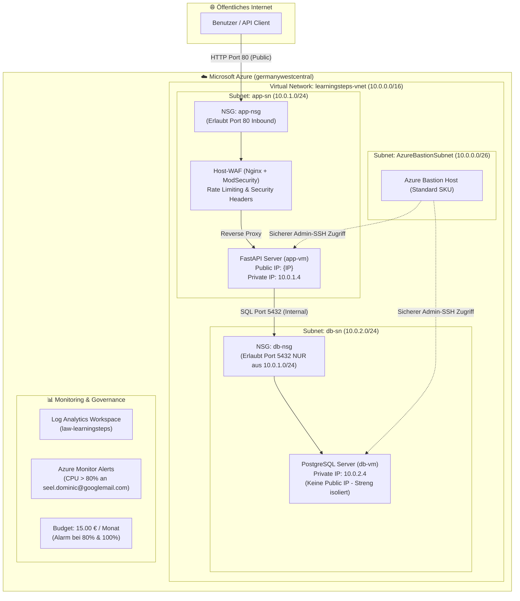

# ☁️ Azure 2-Tier Architecture: Technical Writeup & Documentation

*Projekt:* **LearningSteps Cloud Deployment**  
*Resource Group:* `learningsteps-lab-rg`  
*Region:* `germanywestcentral`  
*Generiert am:* `26.10.2026 09:31:54`  
*Subscription:* `Dominic Sebastian Seel - Sub` (`<azure-aub-id>`)

---

## 1. Architektur-Übersicht (2-Tier Setup)

Die LearningSteps API wurde in einer abgesicherten 2-Tier-Architektur auf Microsoft Azure bereitgestellt. Das Setup trennt die öffentliche Applikationsebene strikt von der internen Datenbankebene.



---

## 2. Live-Status der Infrastruktur

### Netzwerk & Instanzen

| Komponente | VM-Name | Private IP | Public IP | Status |
| :--- | :--- | :--- | :--- | :--- |
| **Tier 1 (App Server)** | `app-vm` | `10.0.1.4` | `{IP}` | Betriebsbereit (Port 80) |
| **Tier 2 (Datenbank)** | `db-vm` | `10.0.2.4` | *Keine (Isoliert)* | Betriebsbereit (Port 5432) |
| **Management** | `bastion-host` | Intern | `bastion-pip` | Standard SKU mit Native Tunneling |

### API Endpunkte & Live-Test

- **Swagger UI**: [http://{IP}/docs](http://{IP}/docs) -> **200 OK (Erreichbar)**
- **GET /entries Live-Response**:

```json
{"entries":[{"id":"73f5920e-c3fe-47b7-b5a2-64a29b9e0d80","work":"Deployed to Azure","struggle":"NIC NSG conflict","intention":"Harden and Monitor","created_at":"2026-10-26T08:12:59.363410+00:00","updated_at":"2026-10-26T08:12:59.363410+00:00"}],"count":1}
```

---

## 3. Sicherheitsentscheidungen (Least Privilege & Defense-in-Depth)

1. **Strikte Subnetz- und Netzwerkisolierung**:
   - Die Datenbank besitzt **keine öffentliche IP**. Eine direkte Erreichbarkeit aus dem Internet ist auf Netzwerkebene physisch unmöglich.
   - Die Subnetz-NSG `db-nsg` limitiert Port 5432 strikt auf das Subnetz der App (`10.0.1.0/24`).

2. **Defense-in-Depth (Mehrstufige Abwehr)**:
   - **Ebene 1 (Cloud Firewall)**: Azure NSG auf Subnetzebene blockiert unautorisierten Datenverkehr.
   - **Ebene 2 (Host WAF)**: Nginx mit ModSecurity analysiert eingehende HTTP-Payloads auf SQL-Injections, XSS und schützt durch Rate-Limiting vor DoS-Angriffen.
   - **Ebene 3 (Host Firewall & Brute-Force)**: Lokale `ufw` auf den VMs und `fail2ban` sperren verdächtige IPs automatisch.
   - **Ebene 4 (System Auditing)**: `auditd` überwacht Änderungen an kritischen Konfigurationsdateien (`/etc/passwd`, `/etc/shadow`, `/etc/postgresql/`).

---

## 4. Herausforderungen & Lösungen (Challenges & Troubleshooting)

| Problem / Herausforderung | Ursache | Lösung |
| :--- | :--- | :--- |
| **Port 80 trotz NSG blockiert** | `az vm create` erstellte automatisch eine zusätzliche NIC-NSG (`app-vmNSG`), die Port 80 abwies. | Entfernen der redundanten NIC-NSGs, sodass ausschließlich die sauberen Subnetz-NSGs greifen. |
| **Interaktiver Dialog blockiert Deployment** | `iptables-persistent` forderte bei der Installation Tastatureingaben im Hintergrund an. | Ergänzen von `DEBIAN_FRONTEND=noninteractive` und `dpkg --configure -a`. |
| **Legacy Budget API Fehler (400)** | Veralteter Preview-Befehl `az consumption budget create` erforderte alte Filtersyntax. | Umstellung auf die moderne ARM Consumption REST-API (`2021-10-01`) mit integrierten E-Mail-Schwellenwerten. |

---

## 5. Key Learnings (Erkenntnisse über Azure Networking)

1. **Subnet-NSG vs. NIC-NSG**:
   - Datenverkehr durchläuft bei eingehenden Verbindungen zuerst die Subnet-NSG und danach die NIC-NSG. Für eine saubere Verwaltung sollten NSGs auf Subnetzebene gebündelt werden, um Inkonsistenzen zu vermeiden.
2. **Azure Bastion Funktionsweise**:
   - Ermöglicht verschlüsselte Administrationsverbindungen zu privaten VMs, ohne dass diese eine Public IP oder exponierte SSH-Ports benötigen.
3. **Kostenkontrolle in der Cloud**:
   - Nicht alle Cloud-Kosten skalieren mit der Nutzung. Pauschal abgerechnete Basis-Komponenten (wie Bastion oder Gateways) erfordern proaktive Budgets und Alerting.

---

## 6. Ressourcen-Inventar

```text
Name                                              Type                                      Location            Status
------------------------------------------------  ----------------------------------------  ------------------  ---------
learningsteps-vnet                                Microsoft.Network/virtualNetworks         germanywestcentral  Succeeded
bastion-pip                                       Microsoft.Network/publicIPAddresses       germanywestcentral  Succeeded
bastion-host                                      Microsoft.Network/bastionHosts            germanywestcentral  Succeeded
app-vmNSG                                         Microsoft.Network/networkSecurityGroups   germanywestcentral  Succeeded
app-pip                                           Microsoft.Network/publicIPAddresses       germanywestcentral  Succeeded
app-vmVMNic                                       Microsoft.Network/networkInterfaces       germanywestcentral  Succeeded
app-vm                                            Microsoft.Compute/virtualMachines         germanywestcentral  Succeeded
app-vm_OsDisk_1_1edcba4483fe445aa90c671662d297f7  Microsoft.Compute/disks                   germanywestcentral  Succeeded
db-vmNSG                                          Microsoft.Network/networkSecurityGroups   germanywestcentral  Succeeded
db-vmVMNic                                        Microsoft.Network/networkInterfaces       germanywestcentral  Succeeded
db-vm                                             Microsoft.Compute/virtualMachines         germanywestcentral  Succeeded
db-vm_OsDisk_1_b22f57edc3d64e8e99216c568eaa9b54   Microsoft.Compute/disks                   germanywestcentral  Succeeded
app-nsg                                           Microsoft.Network/networkSecurityGroups   germanywestcentral  Succeeded
db-nsg                                            Microsoft.Network/networkSecurityGroups   germanywestcentral  Succeeded
ag-learningsteps-admin                            Microsoft.Insights/actiongroups           global              Succeeded
alert-app-vm-cpu-high                             Microsoft.Insights/metricalerts           global              Succeeded
alert-db-vm-cpu-high                              Microsoft.Insights/metricalerts           global              Succeeded
law-learningsteps                                 Microsoft.OperationalInsights/workspaces  germanywestcentral  Succeeded
```

### Konfigurierte NSG-Regeln

**app-nsg:**

```text
Name           Priority    Direction    Access
-------------  ----------  -----------  --------
Allow-HTTP-80  100         Inbound      Allow
```

**db-nsg:**

```text
Name                       Priority    Direction    Access
-------------------------  ----------  -----------  --------
Allow-Postgres-From-AppSN  100         Inbound      Allow
```

### Monitoring & Budget Status

**Aktive Metrik-Alerts:**

```text
Name                   Enabled    Severity
---------------------  ---------  ----------
alert-app-vm-cpu-high  True       2
alert-db-vm-cpu-high   True       2
```

**Kosten-Budget:**

```text
Name              Amount    TimeGrain    Category
----------------  --------  -----------  ----------
budget-lab-15eur  15.0      Monthly      Cost
```
