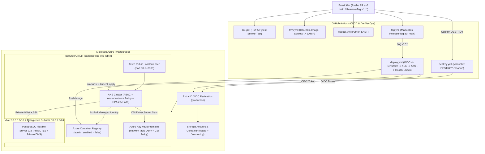
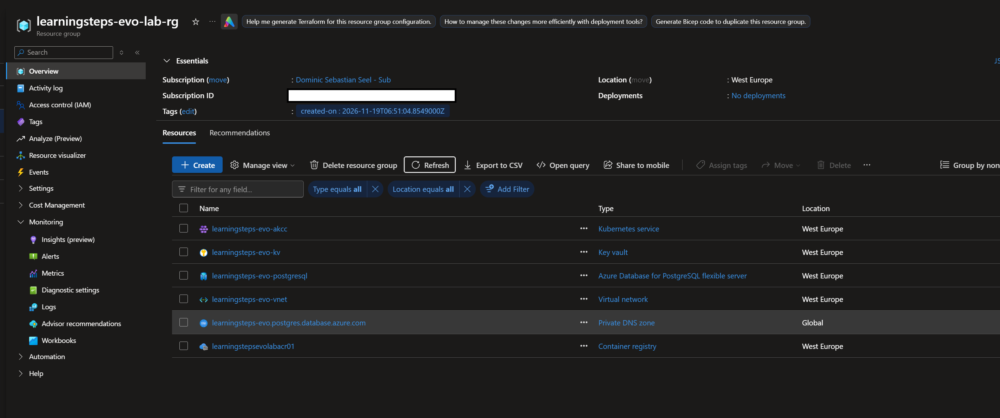
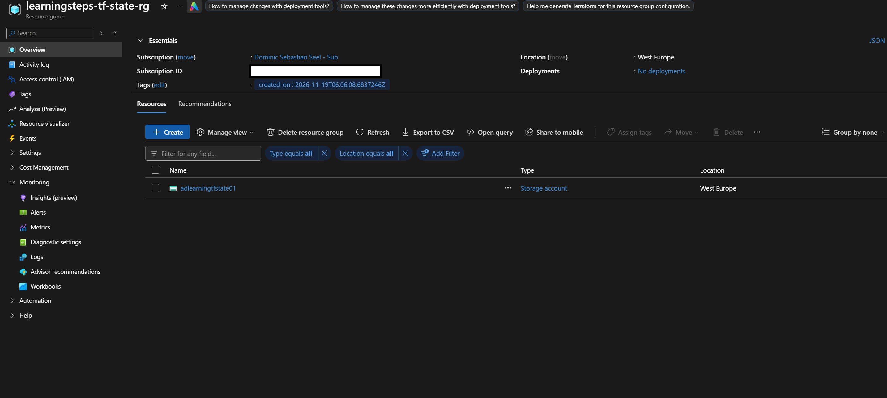
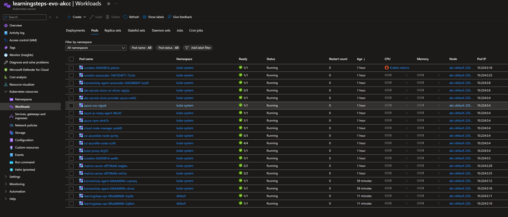
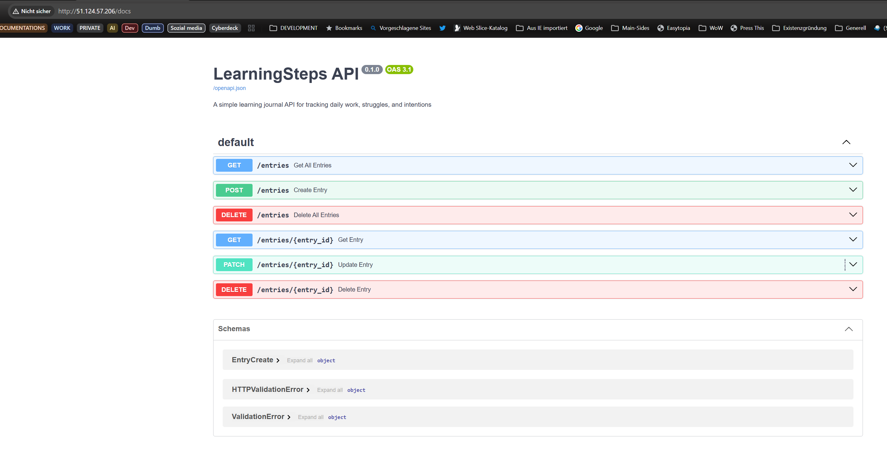
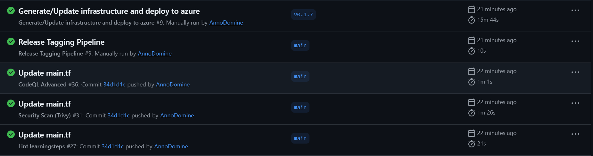
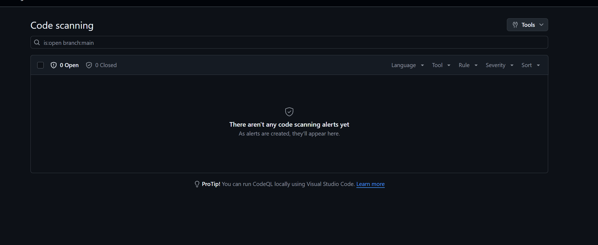
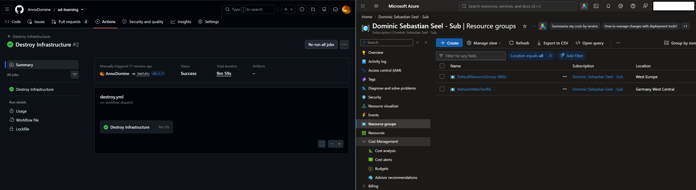

# ☁️ LearningSteps Evolution: Executive Summary

*Projekt:* **LearningSteps Cloud-Native DevSecOps & AKS Transformation (Projekt 2)**  
*Autor:* **Dominic Sebastian Seel**  
*Resource Group:* `learningsteps-evo-lab-rg` *(Remote State separat verwaltet)*  
*Region:* `westeurope`  
*Status:* ✅ **Core-Meilensteine (Steps 1–5) vollständig umgesetzt, gehärtet & live verifiziert**

---

## 1. Projektübersicht & Transformation (Origin → Evolution)

Aufbauend auf **Projekt 1 ([LearningSteps Origin](../origin/ORIGIN_SUMMARY.md))** wurde die FastAPI-Anwendung von einer manuell bzw. skriptgesteuert betriebenen 2-Tier-VM-Landschaft in einen vollständig deklarativen, containerisierten und durch DevSecOps-Pipelines abgesicherten Cloud-Native-Lebenszyklus auf Microsoft Azure überführt.

| Dimension | Projekt 1: Origin (VM-basiert) | Projekt 2: Evolution (Cloud-Native) |
| :--- | :--- | :--- |
| **Compute & Runtime** | Ubuntu VMs + systemd + Nginx/ModSecurity WAF | Gehärtetes Python `3.13-slim` Container-Image in **ACR** & **Azure Kubernetes Service (AKS)** |
| **Provisionierung** | Imperative Azure-CLI-Skripte (`create_az_environment.sh`) | Deklaratives **Terraform** (`infra-terraform/`) mit verschlüsseltem Azure-Storage-Remote-State |
| **Datenbank** | Self-Hosted PostgreSQL auf dedizierter VM (`db-vm`) | Managed **Azure Database for PostgreSQL Flexible Server** (v18, privat via VNet-Delegation & Private DNS) |
| **Secret Management** | `.env`-Dateien auf VM | **Azure Key Vault (Premium)** + **Secrets Store CSI Driver** (`SecretProviderClass`) zur Pod-Laufzeit |
| **Authentifizierung** | Manuelle CLI-Session / SSH via Bastion | Passwortlose **GitHub Actions OIDC Workload Identity Federation** (`environment: production`) |
| **Security & Qualität** | Host-Hardening (`ufw`, `fail2ban`, `auditd`) | **Shift-Left DevSecOps:** Ruff, Pytest, CodeQL & **Trivy** (IaC, K8s, Image, Secrets → SARIF) |
| **Betrieb & Recovery** | `pause_vms.sh` / `start_vms.sh` | Reproduzierbares Tag-Deployment (`deploy.yml`) + vollständiges Teardown-Gate (`destroy.yml`) |

---

## 2. Zielarchitektur

---

## 3. Erfüllte Erfolgskriterien (Success Criteria Audit)

Abgleich gegen die Erfolgskriterien aus [`02_learningsteps_evolution.md`](../../02_learningsteps_evolution.md#L117-L124):

| Kriterium | Vorgabe | Nachweis & Umgesetzte Lösung | Status |
| :--- | :--- | :--- | :---: |
| **Continuous Deployment** | Code-Änderung pushen und automatisch über die Azure Public IP live sehen. | Tag-basiertes Deployment via [`tag.yml`](../../.github/workflows/tag.yml) & [`deploy.yml`](../../.github/workflows/deploy.yml) mit automatischem `health-check`. FastAPI Swagger UI live verifiziert unter `http://20.71.5.147/docs`. | ✅ |
| **Security Enforcement** | Nachweis, dass die Pipeline bei unsicheren Paketen oder IaC-Regeln fehlschlägt. | [`trivy.yml`](../../.github/workflows/trivy.yml) blockierte initial reproduzierbar bei `HIGH`/`CRITICAL`-Funden in Terraform, Docker-Image und K8s-Manifesten (`exit-code: "1"`). Nach systematischem Hardening laufen alle 4 Scan-Gates mit `0` Blockern durch. | ✅ |
| **Infrastructure Recovery** | `terraform destroy` und erneutes `terraform apply` stellen die gesamte Umgebung wieder her. | Dedizierte [`destroy.yml`](../../.github/workflows/destroy.yml) inklusive `"DESTROY"`-Guardrail und idempotentem Remote-State-Bootstrap in [`deploy.yml`](../../.github/workflows/deploy.yml) live getestet und verifiziert. | ✅ |
| **(Optional) Visual Insights** | Live-Grafana-Dashboard mit realen API-Metriken. | Optionales Step-6-Ziel (`prometheus_client`, Prometheus & Grafana Stack) als definierter nächster Ausbauschritt dokumentiert. | ⏳ *(Optional)* |

---

## 4. Bewusste Best-Practice-Abweichungen

Gemäß [`ROADMAP.md`](ROADMAP.md) wurden gegenüber dem Standard-Beispiel aus der Aufgabenstellung gezielt produktionsnahe Verbesserungen umgesetzt:

1. **Saubere Root-Struktur:** Infrastruktur (`infra-terraform/`), Orchestrierung (`k8s-manifests/`), `Dockerfile` und `.github/workflows/` liegen getrennt vom Applikationscode ([`learningsteps/`](../../learningsteps/)) im Repository-Root.
2. **Aufgeteilte Event-getriebene Workflows:** Qualität & Sicherheit (`lint.yml`, `trivy.yml`, `codeql.yml`) laufen auf Push/PR nach `main`; Infrastruktur-Provisionierung und Rollouts (`deploy.yml`) starten ausschließlich kontrolliert per Semantic-Tag (`v*.*.*`) über `tag.yml` oder manuellen Trigger.
3. **Zero Long-Lived Secrets (OIDC):** Authentifizierung gegen Azure erfolgt über kurzlebige OIDC-Tokens, gebunden an das GitHub-Environment `production`.
4. **Supply-Chain-Sicherheit:** Sämtliche GitHub Actions sind auf vollständige 40-stellige Commit-SHAs gepinnt (`# vX.Y.Z`).

---

## 5. DevSecOps & Defense-in-Depth Sicherheitskonzept

Sicherheit wurde durchgängig auf vier Ebenen (*Infrastructure*, *Container*, *Kubernetes* und *CI/CD*) erzwungen und mittels Trivy nachgewiesen:

| Ebene | Initiale Findings (Baseline) | Umgesetzte Härtungsmaßnahmen | Finaler Status |
| :--- | :---: | :--- | :---: |
| **Terraform IaC** | 19 Findings *(3 CRITICAL, 2 HIGH)* | `tfstate`-Storage aus `main.tf` ausgelagert (`AZU-0012`); Key-Vault-Firewall `default_action = "Deny"` (`AZU-0013`); AKS API-IP-Beschränkung (`AZU-0041`), RBAC (`AZU-0042`) & Azure Network Policy (`AZU-0043`); ACR `admin_enabled = false` + `AcrPull`-RBAC | **0 `HIGH`/`CRITICAL`** |
| **Docker-Image** | 186 Findings *(49 HIGH)* | Fix auf `python:3.13-slim`; OS-Patching via `apt-get upgrade` (`zlib1g`); gepatchte Minimum-Versionen (`msgpack>=1.2.3`, `urllib3>=2.8.0`); Entfernung von `pip`, `setuptools` & `ensurepip` im Image; Non-Root `apiuser` | **0 fixbare `HIGH`/`CRITICAL`** |
| **Kubernetes** | 3 Findings *(3 HIGH)* | Pod-`securityContext` (`runAsNonRoot: true`, `runAsUser/Group: 1000`, `RuntimeDefault` Seccomp) + Container-`securityContext` (`readOnlyRootFilesystem: true`, `allowPrivilegeEscalation: false`, `capabilities.drop: [ALL]`) (`KSV-0014`, `KSV-0118`) | **0 `HIGH`/`CRITICAL`** |
| **Secrets & SAST** | 0 Findings | Trivy Secret-Scan (`scan-fs`), GitHub CodeQL (`codeql.yml`), dynamische `envsubst`-Injektion ohne Secrets im Git, GitHub Secret-Masking berücksichtigt | **0 Secrets / 0 Alerts** |

---

## 6. CI/CD-Pipelines & Infrastructure Recovery

Die vollständige Automatisierung verteilt sich auf sechs Workflows unter [`.github/workflows/`](../../.github/workflows/):

* **[`lint.yml`](../../.github/workflows/lint.yml):** Parallele Ausführung von Ruff (`check` + `format --check`) und Pytest-Smoke-Test (`test_smoke.py`) mit Coverage-Report.
* **[`trivy.yml`](../../.github/workflows/trivy.yml):** Vier parallele Scans (`scan-terraform`, `scan-k8s-manifests`, `scan-image`, `scan-fs`) mit `limit-severities-for-sarif: true` und zentralem SARIF-Upload.
* **[`codeql.yml`](../../.github/workflows/codeql.yml):** Kontinuierliche Python-SAST-Analyse.
* **[`tag.yml`](../../.github/workflows/tag.yml):** Erstellt nach Duplikat-Check annotierte `v*.*.*`-Tags strikt auf `main`.
* **[`deploy.yml`](../../.github/workflows/deploy.yml):** Kaskadierendes Remote-State-Setup (inkl. TLS 1.2 & Versioning), Pre-Plan- & Post-Apply-Key-Vault-Firewall-Freigaben, `terraform apply`, ACR-Push, AKS-Firewall-Update, `envsubst` + `kubectl apply`/`rollout status` und abschließender Live-`health-check` mit `$GITHUB_STEP_SUMMARY`-Ausgabe.
* **[`destroy.yml`](../../.github/workflows/destroy.yml):** Manueller Komplett-Abbau mit expliziter `confirm == 'DESTROY'`-Sperre; löscht nach erfolgreichem `terraform destroy` auch die separate `tfstate`-Resource-Group.

---

## 7. Visuelle Nachweise (Azure & GitHub Screenshots)

> Die folgenden Screenshots werden unter [`documentation/evolution/images/`](images/) abgelegt (siehe [Screenshot-Checkliste](images/README.md)).

### 7.1 Azure-Infrastruktur & Remote State

*Abbildung 1: Vollständig per Terraform provisionierte Ressourcen in `learningsteps-evo-lab-rg` (AKS, PostgreSQL Flexible Server, Key Vault, ACR, VNet & Private DNS).*

*Abbildung 2: Automatisiert über `deploy.yml` angelegter Azure Storage Container (`tfstate`) mit aktiviertem Blob-Versioning.*

### 7.2 AKS-Workloads & Live-API

*Abbildung 3: Laufende `learningsteps-api`-Pods auf AKS inklusive HPA (2–5 Replicas) und öffentlichem LoadBalancer-Service.*

*Abbildung 4: Live-Verifikation der API-Dokumentation (`http://<EXTERNAL-IP>/docs`) über die vom `health-check`-Job gemeldete Azure Public IP.*

### 7.3 DevSecOps-Pipelines, Security-Tab & Recovery

*Abbildung 5: Erfolgreiche Durchläufe von `Lint learningsteps`, `Security Scan (Trivy)`, `Release Tagging Pipeline` und `deploy`.*

*Abbildung 6: Konsolidierte SARIF-Sicherheitsberichte im GitHub Security Tab (Terraform, K8s-Manifeste, Docker-Image, Secrets & CodeQL).*

*Abbildung 7: Verifizierter Komplett-Abbau über `destroy.yml` als Nachweis für reproduzierbare Infrastructure Recovery und Kostenkontrolle.*

---

## 8. Key Learnings, Fazit & Ausblick

### Wichtigste technische Erkenntnisse
1. **Remote State gehört nicht ins eigene `main.tf`:** Ein idempotenter Bootstrap-Step vor `terraform init` löst das Henne-Ei-Problem beim Erstaufbau und verhindert, dass `terraform destroy` seinen eigenen State löscht.
2. **Strenge Key-Vault-Firewalls erfordern CI/CD-Awareness:** Sowohl wechselnde GitHub-Runner-IPs (schon während `terraform plan`) als auch die effektive AKS-Node-Outbound-IP müssen gezielt autorisiert werden.
3. **GitHub OIDC & Secret-Masking im Detail:** GitHub inkludierte numerische Owner-/Repo-IDs im `sub`-Claim (`@6992858`/`@1437016446`) und filtert Job-Outputs heraus, die exakt einem Repository-Secret (`AZURE_TENANT_ID`) entsprechen.
4. **Hardening bis ins Runtime-Image:** Erst die Entfernung von `pip`, `setuptools` und `ensurepip` beseitigt vendored Python-CVEs vollständig; im Kubernetes-Cluster benötigt `runAsNonRoot: true` zwingend eine numerische UID (`runAsUser: 1000`).

### Weiterführende Dokumente & Ausblick
* **Chronik & Troubleshooting-Log:** [`EVOLUTION_JOURNAL.md`](EVOLUTION_JOURNAL.md)
* **Detailnotizen:** [`step_1_docker.md`](notes/step_1_docker.md) · [`step_2_iac.md`](notes/step_2_iac.md) · [`step_3_security.md`](notes/step_3_security.md) · [`step_4_workflows.md`](notes/step_4_workflows.md) · [`step_5_kubernetes.md`](notes/step_5_kubernetes.md)
* **Ausblick (Step 6 – Optional):** Instrumentierung der FastAPI-App mit `prometheus_client` (`/metrics`) sowie Bereitstellung von Prometheus & Grafana im AKS-Cluster zur Visualisierung von Latenz, Request-Rate und DB-Status.
